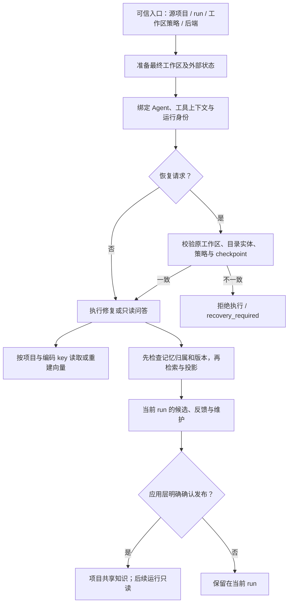

# S5：边界回归与设计说明

S1–S5 的目标是本地单用户、多项目、并发修复：每次运行有明确的代码目录和可变状态，
同项目可复用派生缓存，影响决策的长期知识通过显式确认共享。S5 把已有边界组合成回归用例，
并给出统一设计说明；不增加身份服务、缓存服务或另一套执行后端。

阶段细节见 [S1 身份与归属](ISOLATION_S1.md)、[S2 运行入口](ISOLATION_S2.md)、
[S3 缓存](ISOLATION_S3.md)、[S4 记忆访问](ISOLATION_S4.md)。这里的隔离阶段与
Workbench / WSL sandbox 的同名 S 阶段是不同计划。

## 设计目标与信任边界

要防止的错误包括：两个修复互相覆盖源码或状态；独立 clone 因相同 remote/commit 串用资源；
项目切换后复用旧检索语料；缓存配置变化后误命中；私有经验通过召回、按 ID 查询、反馈或维护
进入另一任务；恢复时绑定错误目录或改变执行策略；分支重跑带入原分支的后续历史。

可信控制面是 CLI/factory、Workbench 控制器及经过校验的 sandbox binding。
这些组件选择源项目、执行副本、run ID、后端和状态根。模型返回的参数、记忆 Candidate、
session 中的记忆身份声明、仓库文本均不能扩大资源访问范围。
底层 SQLite/store API 和 Python 应用调用者属于可信程序，必须经治理入口暴露给 Agent；
它们本身不是多租户鉴权接口。

工作区分离与执行权限分开处理。`worktree` 解决编辑哪份代码；`wsl_bwrap` 的任务绑定解决
仓库代码能访问哪些文件、进程和网络资源。`legacy` 宿主工具具有宿主权限，独立 worktree
不能阻止恶意命令访问宿主其他文件；Docker 验证也不能替其他宿主工具提供隔离。

## 身份与资源矩阵

| 维度 | 身份来源 | 资源或规则 |
| --- | --- | --- |
| 用户 / principal | 当前生产运行时固定 `local` | 治理层检查 principal；没有登录或跨系统用户鉴权 |
| 项目 | 规范化源项目绝对路径的哈希 | 路径注册稳定；独立 clone 默认独立；副本由可信入口携带来源 |
| 工作区 | 实际执行目录路径哈希 | worktree 或 Workbench 物化副本；与项目 ID 分离 |
| 目录实体 | 记录的设备号、inode 与路径 | sandbox binding、入口 checkpoint 和 ownership lease 校验，防止恢复时目录被替换 |
| Run / task | 控制器分配并校验的 run ID | 当前 repair 的 task 等于 run；状态、候选、权限和回执随运行绑定 |
| 会话 / 分支 | SQLite 会话树与当前节点的祖先链 | 分支重跑保留旧历史，但只把新节点的祖先作为对话上下文 |
| 内容版本 | 当前执行目录的 bounded inventory | 版本限定知识另查文件内容；路径/branch/commit 不能代替脏工作区版本 |
| 编码版本 | 不可变模型 revision 与完整编码描述符 | 同输入、同配置复用向量；改变配置或实际编码文本产生新 key |

路径哈希负责稳定命名，不是秘密或权限令牌。`project_id` 不随源码修改改变；
`workspace_id` 不表示源码版本；目录实体相同也不代表源码未变。

| 资源 | 存储与复用范围 | 访问 / 变更边界 |
| --- | --- | --- |
| 公共 runtime、tokenizer、模型权重 | 产品级公共文件 | 可共享；不连带共享任务状态、凭据和对话 |
| 执行代码、候选补丁 | 每个工作区 / run | 默认 worktree；Workbench 每 run 副本，候选经预览应用才改源项目 |
| Session、trace、checkpoint、候选记忆 | 外部 run 状态根 | 同 run 恢复；项目相同不合并可变状态 |
| 摘要、检索语料、当前观察与工作记忆 | 当前运行 / 会话 | 摘要随运行状态保存；命中 embedding 不导入其他运行的 note 或语料 |
| Embedding | 源项目的 `caches/embeddings-v2` | 同项目 worktree / 运行副本共享，独立 clone 分区；损坏重算 |
| 长期项目知识 | 源项目的 `knowledge` | 显式确认发布；durable 的 repository / repository_version 可跨 run 只读召回 |
| 修复先例 | 当前 run 状态根 | 排名之前检查项目、principal、task；不自动写入共享知识 |
| 审批、执行回执、依赖安装与生命周期资源 | 已有 sandbox task binding | 沿用任务身份、generation 和权限检查；不随记忆发布或缓存复用转移权限 |

## 控制流与失败处理



初始化失败不自动改用源仓库或宿主后端。恢复缺少身份、工作区策略或 binding 信息时不当作
新任务重跑；托管 checkout 校验 ownership lease 后复用，保留已有候选文件。
checkpoint 内容修改不等于策略漂移：合法的保留副本可以含有未提交的补丁，版本限定知识
则根据当前内容重新决定是否召回。

Embedding 丢失、损坏或不可写，按 miss 重算，保留新向量在内存；原子替换避免发布半文件。
本地记忆持久化初始化失败保留当前运行内存，并报告 `memory_only`；显式发布失败返回错误。
不能因此回退到源仓库目录、另一项目数据库或无归属历史记录。

记忆访问检查先于评分和 prompt 投影，也覆盖直接按 ID 修改、usage 反馈、冲突与 Dream。
共享读取获得的是知识候选，不是写权；本次修复的使用反馈不能更新共享记录。
发布 run/task 记忆会创建 repository 记录并保留来源 run 与父记忆 ID，不改变原候选的范围。
发布只提供应用层 API，当前没有模型工具或 HTTP/UI 发布入口。

## 回归矩阵

新增 [组合回归](../tests/test_isolation_regressions.py) 使用实际 factory、Agent、入口恢复、
Git worktree、SQLite/store、embedding 文件和 Workbench 对话树。

| 场景 | 关键断言 | 对应新增用例 |
| --- | --- | --- |
| 同项目两次并发运行 | 代码、workspace、状态、task 记忆各自独立；缓存根相同；源项目未改 | `test_concurrent_entries_partition_code_state_memory_and_cache[same-project]` |
| 同内容 clone、相同 run 名并发 | 项目、workspace、状态、记忆命名空间、缓存根不同；内容相同不合并归属 | 同用例 `[clones]` |
| 保留 checkout 恢复 | 保留候选与 run 记忆；旧向量从磁盘命中；内容变化隐藏旧版本知识并产生新缓存 key | `test_retained_checkout_resume_keeps_run_memory_but_rechecks_content_and_policy[resume]` |
| 改变执行策略后恢复 | `recovery_required`，未进行 snapshot、repair body 或编码；原记忆和候选保留 | 同用例 `[policy-drift]` |
| 错误记录进入正确数据库 | 跨项目、跨 run、缺失归属记录都不进入实际模型 prompt，不接受反馈，不修改原记录 | `test_misrouted_persisted_record_never_enters_model_prompt_or_feedback` |
| 同执行目录重新声明源项目 | Session 恢复拒绝项目重新归属；原记忆仍可由原调用者读取 | `test_session_restore_cannot_relabel_source_project_in_same_execution_directory` |
| Workbench 历史编辑分叉 | 新 run/状态/副本；只带祖先历史；私有候选不串用；显式发布知识可见且不被读取/终结更新；重开保留原分支 | `test_workbench_fork_shares_only_published_knowledge_and_ancestor_history` |

已有分阶段用例继续覆盖：

| 测试文件 | 补充边界 |
| --- | --- |
| `test_project_resource_identity.py` | 原目录替换、跨项目 binding 恢复、错误 owner 清理拒绝 |
| `test_run_entry_isolation.py` | 脏仓库停止、显式 provided、CLI 默认与交付目录、WSL 策略摘要 |
| `test_embedding_cache_isolation.py` | 配置失效、损坏/写失败、跨进程原子发布、长路径、语料重建 |
| `test_memory_access_boundaries.py` | principal、空 task、直接 ID、维护、未知版本、发布拒绝、Markdown 旁路 |
| `test_workbench_isolation.py` | 并发候选、取消、源项目应用冲突、外部编辑保护 |

组合回归的 repair body 是确定性替身，用于验证真实入口和资源接线，不用于证明完整 LLM
修复能力。Workbench 使用显式 in-process 测试 adapter，生产 ProjectExecutor 和 AgentLoop
实际构造 prompt、调用 fake client；不据此声明生产 worker 进程隔离已重新实测。
假 encoder 只替代模型计算，缓存持久化和命中仍经过生产代码；不评价真实模型性能。

相关回归命令（不是全仓测试）：

```powershell
python -m pytest tests/test_isolation_regressions.py tests/test_project_resource_identity.py tests/test_run_entry_isolation.py tests/test_embedding_cache_isolation.py tests/test_memory_access_boundaries.py tests/test_workbench_isolation.py -q --basetemp=.runtime-tools/isolation-s5-regression -p no:cacheprovider
python -m ruff check tests/test_isolation_regressions.py
python -m ruff format --check tests/test_isolation_regressions.py
git diff --check
```

命令中的 basetemp 应使用本次验证的新目录，避免混入上一轮临时资源。
测试不需要远程 LLM、模型下载或真实 WSL；WSL 的实机能力与环境门禁仍由已有 sandbox
验收负责，不能把 fake backend 用例解释为操作系统边界证明。

本次开发验证（2026-10-12）：新增组合回归 9 项通过，已有五个边界测试文件共 92 项通过，
合计 101 个不同用例。Ruff lint、Ruff 格式检查及 Git 差异检查均通过。
提交前仅对新增测试文件应用 Ruff 格式化，前后 AST 哈希一致，沿用已通过的测试结果；
未运行全仓测试。

## 面试说明与后续范围

可先说明：“我按资源生命周期拆隔离。控制器确定 project、workspace、run；每个修复编辑
独立副本，可变状态留在 run。工作区策略与执行后端独立，所以 worktree 只解决代码冲突，
仓库命令的宿主访问限制由 WSL/bwrap 负责。Embedding 是派生数据，可在同项目内按文本和
编码配置复用；记忆影响决策，因此先检查归属与版本，私有候选只有显式确认发布才跨 run
共享。恢复校验原目录实体、策略和所有权，失败就停止。回归还会故意向正确数据库放入
错误归属记录，确认它不会进入模型上下文。”

追问时能明确回答：

| 追问 | 当前实现与取舍 |
| --- | --- |
| 为什么不用 remote/commit 作为项目 ID？ | 它们相同不代表是同一注册项目；源路径决定归属，内容版本另算 |
| worktree 是否完整安全隔离？ | 共享 Git 管理区，宿主模式仍有宿主权限；应用层分区与 OS 沙箱分别解释 |
| 缓存共享是否等于记忆共享？ | 共享的是完整 key 绑定的向量，检索语料独立；长期知识另走确认和只读边界 |
| user_id 是否已支持多租户？ | 治理规则有 principal 校验；生产固定 local，没有可信身份认证和跨用户文件权限体系 |
| 为什么恢复不重新创建 checkout？ | 原候选可能是未提交修改；复用前验证所有权和目录实体，找不到就停止 |
| 版本哈希是否证明当前事实？ | 只覆盖 bounded inventory，非文件系统原子快照；仍需当前工具证据和实际验证 |
| 为什么不自动沉淀所有成功修复？ | 成功修复不证明经验适用于其他任务；默认保留本地候选，确认后才共享 |

MVP 当前没有多租户认证、跨用户隔离、项目共享知识管理 UI、缓存容量/TTL/LRU/GC、
跨机器身份注册、分布式锁及资源配额管理。版本清单有文件数与字节预算，读取失败或超限时
版本限定记忆不召回；这不构成完整防侧信道、防提示注入或恶意宿主命令能力。
迁移到服务部署时，应先接入可信 principal 与项目授权，把控制面存储移到 worker 无权访问
的位置，再补配额、清理策略与发布管理；不直接把本地路径哈希当成租户鉴权。
