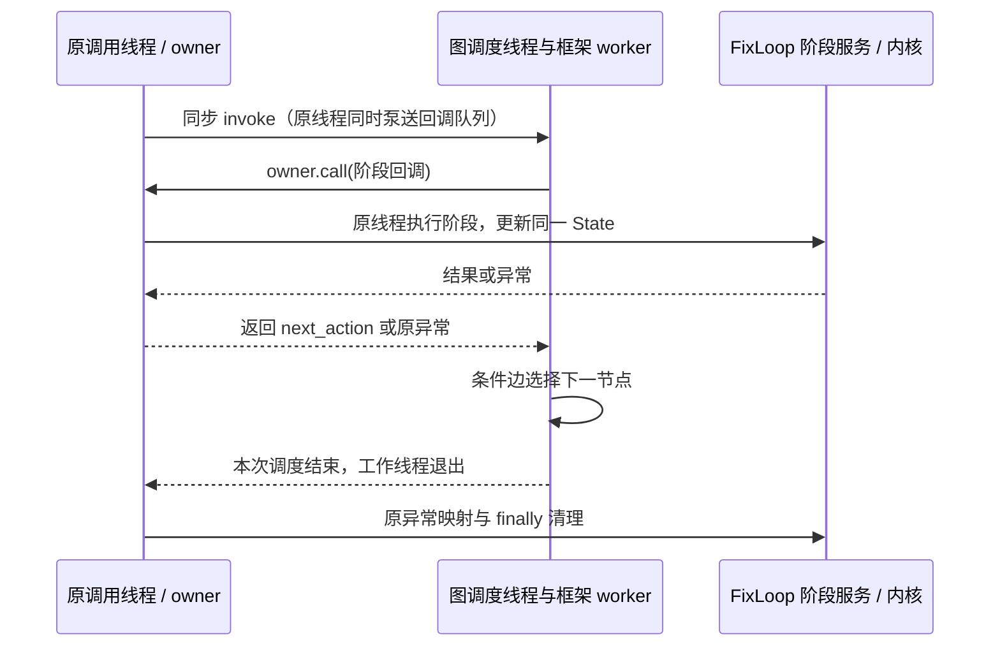

# LangGraph 编排设计与讲解（D6）

FixLoop 使用 LangGraph 组织 Layer 2 的修复阶段。通用 Agent、工具执行、业务状态、
持久化和恢复仍由原内核负责。公开入口为 `RepairService.run(RepairRequest)`。

## 从哪里读代码

| 文件 | 负责什么 |
| --- | --- |
| `src/repair/service.py` / `execution/lifecycle.py` | 请求、工作区、预算、总超时与最终交付 |
| `src/repair/coordinator.py` | 启动、恢复、异常映射、阶段超时、收尾与 finally |
| `src/repair/graph.py` | `STAGE_ROUTES`、编译图和临时路由 |
| `src/repair/graph_stages.py` | 各阶段调用既有服务，返回下一动作 |
| `src/repair/attempt_policy.py` | 空补丁、Critic、验证失败的原业务策略 |
| `src/repair/graph_owner.py` | 将阶段回调送回原执行线程 |
| `src/repair/plan_binding.py` / `agent_runtime/plan_runtime/` | Plan、操作回执、验证证据与恢复核验 |

先读 `STAGE_ROUTES` 看完整控制流，再读关心的阶段方法和策略。实际编译图导出为
[LANGGRAPH_REPAIR_FLOW.mmd](LANGGRAPH_REPAIR_FLOW.mmd)，不依赖外部图服务。

| 节点 | 决策与副作用归属 |
| --- | --- |
| entry / prepare | 取消检查；新执行准备证据，恢复进入 attempt |
| attempt | 原尝试额度和取消门禁 |
| patch / empty_patch | 原 Patcher 与空补丁归因、反馈、计数和止损 |
| critic / protected_interface | 审查与接口保护，拒绝时按原协议回滚再重试 |
| verification_gate / pending_verify | 原验证开关；关闭时只能待验证 |
| verify | 原真实验证与结果分类，只有有效测试通过才能 fixed |
| verification_failure | 原回滚、失败账本、当前反馈、计数和止损 |

条件边只读取阶段返回的 `next_action`，不调用模型、工具、回滚或 checkpoint。
图的 END 表示调度结束；公开终态还要经过内核的结果与清理核查。

## State 和持久化为什么保留

`StateGraph` 仍需要图数据 schema，本实现是只有 `next_action` 的 `RepairRoute`。
它是单次执行的临时数据，不保存业务对象，不承担恢复职责。

| 数据 | 位置 | 恢复时如何处理 |
| --- | --- | --- |
| next_action | 临时图数据 | 丢弃，重新进入图 |
| RepairState | runtime context 指向原实例 | 原 checkpoint 校验和加载 |
| ExecutionSession、资源句柄、预算 | runtime context 指向原会话 | 原 lifecycle 重新绑定与核查 |
| FSM phase / revision | 原业务 State 与契约 | 校验业务阶段，不能据此证明写入完成 |
| Plan 节点、操作回执、验证证据 | 原 Plan journal / blob / checkpoint | 原恢复器核查实际效果并接纳已完成操作 |

不配置 LangGraph checkpointer、Store、interrupt、节点缓存、节点自动重试或节点超时。
这样只有一套业务事实和一套持久化协议。代价是本项目的恢复能力仍需要自己维护，
也不提供任意图节点的框架断点续跑。

## 线程与异常边界

PlanSession 和业务 ContextVar 要求阶段服务在原 owner 线程运行。串行图只能表达
先后顺序，不能保证框架执行服务时不切线程，因此采用 owner 调用桥：

桥只传递回调、结果和异常，不持有业务决策。模型和工具预算不会按节点重置；
取消、总超时、阶段累计超时仍由原协议处理。等待审批退出本次图执行，批准后的
公开恢复入口重新进图，再由内核接续精确操作。

额外成本是图依赖、调度线程、队列桥及相关测试。未测量其延迟和资源开销；
本次不声称性能、Token 消耗或修复率改善。

## 如何扩展工作流

已有的“验证失败诊断”给出实际例子：`verify` 只分类结果，失败后路由到独立的
`verification_failure`，由原策略按“确认回滚 → 更新失败账本 → 构建当前反馈 →
止损与计数 → checkpoint”执行，再选择 attempt / done。

拆分前需要在阶段循环里追踪上述分支；现在可以从图上定位分支，再单独阅读策略。
这次拆分没有增加诊断模型调用或新修复算法。

若后续确需新增阶段：

1. 在 `RepairStages` 增加有明确输入和返回动作的方法，复用既有服务和内核协议。
2. 在 `STAGE_ROUTES` 注册节点和前后连接；条件边保持无副作用。
3. 明确新增业务事实写入原 State/Plan 的位置。路由临时值不能替代执行回执。
4. 定向验证成功、拒绝、失败、取消、恢复，以及副作用次数和顺序；重新导出流程图。

不在这里提供未经实现的新修复策略。现有独立分支可用
`tests/test_repair_graph.py::test_failed_verification_rolls_back_before_current_feedback_and_retry`
和 [retry 演示](LANGGRAPH_DEMO.md) 检查。

## 面试时如何准确介绍

可以用下面这段开场，再结合实际演示展开：

> 我在 FixLoop 中使用 LangGraph 的 StateGraph 表达修复阶段、条件分支和重试循环。
> 我保留了原有 Agent 执行内核、RepairState 和 checkpoint。图只传下一动作，通过
> runtime context 访问同一业务状态；工具权限、预算、取消和恢复仍由内核控制。
> 接入时重点解决了图执行线程与 Plan owner 线程的边界，并用真实工具、pytest、
> 进程退出恢复和并发隔离做验证。主要收益是流程可读、分支可扩展和便于解释。

常见追问可以对应到实际证据：

- **为什么不用框架持久化？** 已有 Plan 和资源回执协议，第二套 checkpoint 会引入
  双重事实与恢复协调成本。本轮目标只涉及编排，保留单一事实来源。
- **与 FSM、Plan 是否重复？** 图选择阶段，FSM 检查业务状态转换，Plan 核查具体
  操作及依赖和执行事实；三者负责的粒度不同。
- **如何避免副作用重放？** 不配置框架节点重试或缓存；崩溃后由原恢复器核验回执，
  不仅凭图位置跳过或重做。D5 验证写入一次、已完成验证不重复、恢复无模型调用。
- **是否用了 LangChain？** 正式编排使用 LangGraph，没有把原模型/工具循环迁到
  LangChain。依赖中出现 langchain-core 不等于项目采用了 LangChain Agent。
- **带来多少提升？** 已交付明确的阶段拓扑和独立分支、可运行的例子与回归证据；
  尚无生产工作流新增耗时、修复率或性能对比数据。

详细约束见 [D1](LANGGRAPH_ORCHESTRATION_BOUNDARY.md)，线程实测见
[D2](LANGGRAPH_EXECUTION_D2.md)，正式接入见 [D3/D4](LANGGRAPH_D3_D4_ACCEPTANCE.md)，
当前定向验收与限制见 [D5](LANGGRAPH_D5_ACCEPTANCE.md)。
