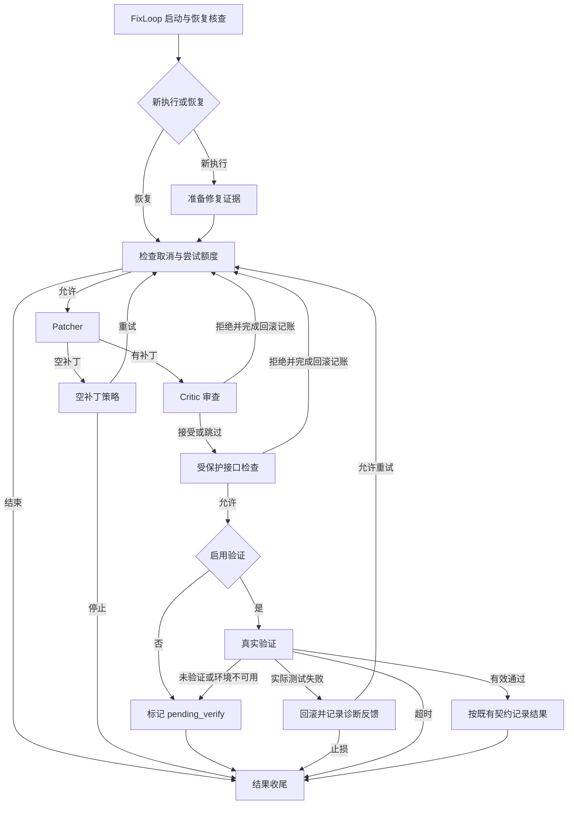

# LangGraph 阶段编排边界与行为矩阵（D1）

日期：2026-10-26。状态：D1 设计基线；D3/D4 已按本边界实现，记录见
[阶段图验收](LANGGRAPH_D3_D4_ACCEPTANCE.md)。

## 目标与范围

用 LangGraph 显式表达修复阶段、条件分支和修复循环，改善工作流扩展、源码阅读和
技术讲解。`RepairService.run(RepairRequest)` 继续是唯一公开入口。

本轮不改变修复策略、模型调用、提示、工具权限、并行度、重试额度和成功条件。
不引入 LangGraph checkpointer、Store、`interrupt()`、节点缓存或节点自动重试。
不迁移模型客户端到 LangChain，不把整个旧 Coordinator 包成单个图节点。

原有业务状态、持久化和执行内核由 FixLoop 持有。D2 负责验证依赖和调用方式；
D3 才实现完整修复图，D4 才接入正式入口。后续交付以本文件行为矩阵为基线。

## 职责与写入归属

| 对象 | 职责／写入者 | LangGraph 边界 |
| --- | --- | --- |
| 图节点与边 | L2 流程定义选择下一个阶段 | 负责连接、分支和循环，不判定工具操作已成功 |
| 临时图数据 | 节点返回下一路由所需的有限枚举 | 不复制业务 State，不作为恢复依据，不落盘 |
| `RepairState` | 现有阶段服务及业务策略更新 | 从运行上下文访问同一实例；不新增第二个 reducer 或镜像 |
| `ExecutionSession` | 持有服务、当前请求、预算与资源 | 通过 runtime context 传入；锁、客户端、句柄不进入图数据 |
| `RepairPhaseFSM` | 校验阶段变化，维护 revision／历史 | 保留；图节点与业务 phase 不要求一一对应 |
| `RepairCoordination` | 更新治理上下文、角色生命周期和阶段事件 | 沿用阶段入口；条件边不得触发这些写入 |
| `PlanSession` / `RepairPlanBinding` | 操作依赖、证据、收据、重规划、恢复核验 | 保留为阶段服务内部执行协议，不把 Plan 节点复制到外层图 |
| checkpoint / journal | FixLoop 保存状态、身份、预算和执行记录 | 保留现有格式、schema 和校验；不保存 LangGraph 节点游标 |
| 超时、取消与清理 | 原有 lifecycle、取消令牌、协调及后端 | 包围整个图调用，不依赖成功走到图的结束节点 |
| 结果与终态 | 验证服务、终态契约和清理结果 | 图的 `END` 只代表本次调度结束，不等同于 `fixed` |

状态来源遵循 `docs/REPAIR_STATE_CONFIG_CONTRACTS.md`：`control` 保存控制，
`execution` 保存身份、checkpoint 和收据，`node_timings` 保存诊断信息。
不把可执行的路由决定或恢复控制新增到 `node_timings`。

## 拟定节点与边

以下保留 D1 设计图。实现将验证结果判定保留在 verify 阶段、正常结果收尾保留在
外层协调器；实际导出拓扑见 [LANGGRAPH_REPAIR_FLOW.mmd](LANGGRAPH_REPAIR_FLOW.mmd)。
路由函数只读节点已经提交的结果。

审批、取消、异常及清理不确定通过现有外层协议退出本次执行，不强制经过
`finish`。准备工作区、恢复加载、owner 获取，以及最终资源释放仍属于 lifecycle。
图中的“准备修复证据”对应 `ExplorationService.prepare_repair`，不重复创建工作区。

## 行为矩阵

| 触发 | 必须保留的动作顺序 | 路由／checkpoint／公开结果 |
| --- | --- | --- |
| 新请求 | 准备最终工作区 → 获取执行权／初始化运行资源 → 准备证据 | 同一 run identity 进入尝试；保留 `repair_started` 事件 |
| 严格恢复 | 原 loader 校验 checkpoint → 原 owner／Plan 恢复核查 → 恢复业务状态 | 重新进入尝试入口；具体完成操作由 Plan 接纳，不仅凭 `phase` 跳过动作；失败不退回新执行 |
| 尝试额度耗尽 | 既有终态解析 | 不调用 Patcher；不新增图层重试计数 |
| 空补丁、明确不能修改／证据不足 | 记录已有 Patcher 终态 → 写反馈 → 保存进度 | 按原策略停止；不额外增加该分支重试计数 |
| 其他空补丁／应用失败／输出截断 | 归因 → 写反馈 → 止损记账 → 增加一次 retry_count → 保存进度 | 原策略选择重试或停止；条件边不再执行上述副作用 |
| Critic 拒绝 | 记录反馈 → 确认回滚 → 清空候选补丁 → 增加一次计数 → 保存进度 | 回尝试门禁；不能先启动验证 |
| 受保护接口拒绝 | 记录反馈 → 确认回滚 → 清空候选补丁 → 增加一次计数 → 保存进度 | 回尝试门禁；保留先于验证开关的检查顺序 |
| 验证关闭 | 通过审查与接口检查 → 标记跳过原因 | `pending_verify`；verify Plan 节点仍未完成 |
| 真实验证有效通过 | 满足 verification_target、非零测试数与最少测试数 → 记录结果 | 才能成为 `fixed`；清理不确定仍优先成为 `recovery_required` |
| 静态、无测试、未验证／环境不可用 | 原验证结果分类 | 不计作修复成功，按原契约保留 `pending_verify` 等结果，不自动再次修改 |
| 真实测试失败 | 记录验证退出 → 确认回滚 → 更新诊断／失败账本 → 构建当前反馈 → 止损 → 计数 → 保存进度 | 回尝试门禁或停止；不增加模型调用，不新增探索策略 |
| 阶段超时 | 原累计阶段时钟 → 取消并确认资源停止 → 原补丁回收／保留／回滚策略 | 原 timeout 结果；计时跨本次执行的重试累计，不用节点 timeout 替代 |
| 总超时 | 原 timer 取消 → 等待执行和取消回调返回 → 核查清理 | 原 timeout／recovery_required；不得遗留写入后提前返回 |
| 用户取消 | 禁止派发 → 原资源树清理 → 仅确认停止后允许回滚 | 原 user_cancel／recovery_required；不通过图自动重试 |
| 工具审批 | 内核保存精确待审批操作 → 映射 SandboxApprovalRequired → 原 checkpoint | 返回 `waiting_approval`；批准后由原入口恢复，不使用 LangGraph interrupt |
| owner 冲突、旧 generation、进程／回滚未确认 | 原核查与稳定原因码 → 关闭新写入 | 原 recovery_required；不尝试图内补救或重放 |
| 未预期异常 | 原异常映射／条件回滚 → finally 清理 | 清理结果优先，保留原 failed／recovery_required 语义 |

## 执行、事件与恢复约束

- 所有分析、修改、验证和上下文提交继续遵守 Plan 的 owner 线程约束。串行图
  本身不能证明线程一致；D2 必须提供可重复的真实 Plan 调用验证。
- 条件边只返回目标，不执行工具、回滚、反馈、事件、计数或 checkpoint。
- 图层不配置 RetryPolicy、节点缓存、并行写或框架超时。图步数限制仅防失控，
  必须覆盖合法业务循环；触发时走原异常清理，不能冒充预算耗尽或验证成功。
- 保留业务阶段累计计时、模型／工具预算和取消传播；不重新设置额度。
- 保留 CLI、Workbench、评测消费的事件与公开结果，避免重复 started／finished、
  重复 phase、重复验证、重复回滚和重复反馈。
- `finally` 继续覆盖图调用及初始化失败；后端关闭、binding 关闭、编辑锁与心跳
  释放顺序依旧由现有资源所有者控制。
- 不承诺任意图节点的断点续跑。恢复只使用原有 checkpoint、Plan 日志与可信收据；
  图名称和临时路由数据不成为新的持久化字段或兼容格式。
- 现有 FSM 是契约检查，Plan 是执行事实协议；本次仅替换 Coordinator 的阶段
  调度循环。保留必要外层异常处理，不为删除 Coordinator 文件而搬动执行内核。

## 后续验收映射

| 范围 | 现有验证入口／补充要求 |
| --- | --- |
| 新执行与恢复行为一致 | `tests/test_repair_flow_parity.py`；同时断言副作用次数和事件顺序 |
| 真工具、真文件和真 pytest | `tests/test_plan_l2_binding.py` |
| 写入后崩溃与结果接纳 | 该文件的 `test_public_repair_resume_after_process_crash` 等定向用例 |
| 回滚与重规划 | `tests/test_plan_replan_binding.py`；保留持久计数及提交门禁 |
| 取消、owner、进程清理未知 | `tests/test_run_coordination*.py`、相关生命周期用例，按实际影响选择 |
| 安装与依赖 | D2 确认实际版本；正式接入后验证 wheel 和现有三类调用端 |
| 可理解性与扩展性 | D3 从实际图定义导出图，展示已有失败诊断分支如何独立成节点 |

仅执行相关测试；失败后按 nodeid 复验。全量测试、真实模型、WSL／Docker 和发布
级验证仍须按 CLAUDE.md 的授权与适用范围执行，不用历史结果代替本次验收。

## 参考

- 正式行为以 [修复契约](REPAIR_CONTRACT.md)、[状态配置契约](REPAIR_STATE_CONFIG_CONTRACTS.md)、
  [Plan DAG](PLAN_DAG.md)、[恢复与取消](RUN_COORDINATION.md) 为准。
- [LangGraph Graph API](https://docs.langchain.com/oss/python/langgraph/graph-api)：节点、运行上下文与边。
- [Interrupt 规则](https://docs.langchain.com/oss/python/langgraph/interrupts)：本次保留 FixLoop 审批协议。
