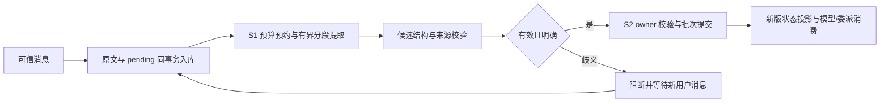

# S3：自然语言自动提取与提交

日期：2026-10-13。分支：`M1/D3/natural-language-context-s3`。基于 S1/S2；本次按用户最新要求启用自动提取。缓存专项不在改动范围内。

## 支持路径与接入时机

保证范围是 `RepairPlanBinding` 管理的 Plan repair 路径，覆盖 XML/native 主循环。

| 来源 | 接入时机 | 可提交内容 |
| --- | --- | --- |
| 原始 Issue | 来源登记后、仓库取证与规划前 | 明确用户约束；用户选择可先 deferred |
| 宿主补充消息 | owner 安全边界调用 `accept_user_message` | 新增、明确替代/撤销、用户节点选择、澄清 |
| 规划结论 | 分析节点成功、编辑节点开始前 | 带分析证据的节点技术决策 |
| owner 可见方案 | 模型返回工具调用后、工具派发前，且尚无已确认副作用 | 带当前节点证据的技术决策 |

模型没有消息登记或状态提交工具。源码、日志、repair 模板、工具参数、子任务回复不能自行声明用户身份；XML 的 `<think>` 和 native thinking 块不接入候选提取。普通 L1 对话未绑定该服务时仍不自动提取。

`AgentConfig.auto_context_extraction` 默认 `True`。可用配置文件或 `FIXLOOP_AUTO_CONTEXT_EXTRACTION=false` 关闭新提取；已存在的待处理记录仍会阻断执行，开关不能抹掉待澄清要求。

## 模块与处理过程



- `agent_runtime/task_extraction.py`：消息接入、快照、分段、模型调用、提取进度、自动提交、澄清与恢复。
- `agent_runtime/task_extraction_schema.py`：模型指令、严格 JSON、字段白名单、原文范围、来源、目标版本、节点和证据校验。
- `agent_runtime/plan_runtime/task_messages.py`：提供纯消息准备接口，以便新消息和 pending 记录在同一 journal 事务中发布。
- `ContextUpdates` / `PlanSession`：复用 S2 的来源与版本链提交；待提取/澄清时拦截上下文消费、编辑/验证准备和修改工具。
- `model_call_budget.py` / `BudgetManager`：预约后、派发前持久化；恢复时合并缺少的 extraction 调用，保留现有额度和更新消耗。
- `src/repair/plan_binding.py` / `loop_protocols.py`：连接原始请求、Plan 后绑定、分析方案、可信补充入口，以及 XML/native 模型与工具边界。

候选包含 `kind`、`action`、`source_refs`，明确替代/撤销还包含目标 ID 和 `expected_revision`；决策绑定 `node_id`。原文引用包含消息 ID/checksum、Unicode code point 起止位置和 exact quote。身份由登记消息决定，不接受模型输出 `source_kind`。

用户来源可以创建硬约束和用户选择；模型来源只能创建技术决策，新增/替代必须关联本次提供的有效技术证据。没有有效节点的用户选择先保存为 deferred；Plan 创建后按原 statement/source_refs 逐项绑定。漏项、增项或无法绑定进入澄清，不静默删除选择。

每条消息所有分段完成校验后才提交一个批次；任一分段有歧义，当前阶段候选均不发布。约束与 deferred 选择可以分阶段提交：初始阶段发布约束，绑定阶段再发布选择；绑定失败不会撤销已确认的初始约束。对活动记录只做同 statement/节点的精确去重，不做语义相似去重。

## 预算与失败边界

| 项目 | 契约 |
| --- | --- |
| 模型调用 | 使用 light_client 或主 client，purpose=`extraction`；共用运行预算、取消和期限 |
| 输入 | 按配置窗口计量；预留候选/格式修复空间；连续分段覆盖整条原文，最多 16 段 |
| 输出 | 单次上限 `min(max_new_tokens, 2048)`；每种候选数组最多 32 项 |
| 格式修复 | 每条消息所有分段及绑定阶段合计最多一次额外修复调用 |
| 解析 | 只接受完整 JSON；拒绝重复 key、额外字段、截断输出、未提供来源/节点/证据 |
| 提交 | 再核对状态与 Plan checksum、证据 freshness，复用 S2 CAS；失败不发布部分批次 |
| 未知调用结果 | 保留预约，不因迟到返回或重启退还；恢复不覆盖当前限额或较新账本 |
| 输入装不下 | 明确阻断，不任意截断原文、权威状态或待绑定条目 |

只有 `clarification_required` 支持通过新用户消息关联解决。格式/预算/状态过期/证据变化等阻断不会自动无限重试或替换旧快照；需要宿主处理诊断并重新安排任务。中断但尚未阻断的记录可以恢复：已有分段不重调用，未知分段最多使用剩余的一次修复机会。

澄清入口为可信宿主 API，不新增聊天 UI 或 CLI 澄清交互：

```python
binding.accept_user_message("user-2", "不要修改测试；保留公共 API")
binding.accept_user_message(
    "user-3", "最终决定保留 API v2，撤销 API v1 的要求",
    resolves=["user-2"],  # 仅当该消息处于 clarification_required
)
```

新消息必须明确重述最终要求/选择；空候选不能解除旧歧义。原消息不可改写。初始请求或 Plan 后绑定需要澄清时，binding 保留宿主入口，模型/修改工具继续阻断。涉及执行不明或在途副作用时仍先走既有执行对账，不能用新要求改变操作事实。

## 恢复与权威状态

提取 ID 由策略版本和消息 checksum 派生；分段 ID 绑定阶段及序号，批次 ID 绑定提取及阶段。journal 保存 pending、分段调用/结果、ready 候选、提交阶段、blocked/resolved 和预算预约。

已保存候选、S2 事务已提交但提取状态未确认等窗口，用同一批次对账；不新增版本、不回滚后来状态。新澄清已提交（或明确选择已进入 awaiting_node）但旧 blocked 尚未标 resolved 时，恢复补齐关联；awaiting_node 仍阻断模型和修改工具。仅登记但未提取的澄清答案优先于旧 blocked 记录恢复，多次澄清携带全部关联来源。重启后已完成提取不再次调用模型；已确认文件写入仍沿用 Plan 恢复采纳，不重复执行。

权威约束/决策继续来自 S2 完整状态与来源记录，不来自历史摘要。`context_revision` 变化使旧委派结果按现有 `task_context_changed` 契约失效；新的委派快照消费新版要求。审计/节点普通推进仍不等价于约束变更。

## 验证与面试表述

受控模型输出验证运行时契约；L2 测试执行真实 read/patch 和宿主 pytest，未调用付费模型。244 项相关用例分批通过（去除重叠计数）；修改后的行为按 nodeid 定向复验，未运行全量测试。Ruff check、17 个修改/新增 Python 文件的 format check 和 git diff whitespace 检查通过。

| 验证组 | 结果 |
| --- | --- |
| 新增 test_task_extraction.py / test_task_extraction_l2.py | 44 项分批通过，含新增与修复后定向复验 |
| 相关回归：test_model_call_budget、test_llm_budget、test_context_updates、test_required_long_task_context、test_decision_projection、test_context_assembly、test_plan_l2_binding、test_plan_replan_binding、test_native_tool_batch、test_config_contracts，加 S3 委派快照集成用例 | 200 项通过；其中 1 项与上述 44 项重叠 |
| 新增配置开关及 provenance | 1 项通过 |
| 消息原子接入调整后的来源回归 | 9 项通过，已包含于相关回归组，不重复计数 |

新增覆盖：中文否定/英文例外候选、替代/撤销、无更新重放、单次格式修复、字段/来源/节点/证据伪造、澄清、deferred 完整绑定、长消息完整分段、取消/期限/预算门禁、证据与快照变化、owner 线程隔离，以及接入/结果/状态事务的进程中断恢复。实际 XML/native 修复验证约束和规划决策进入请求；写入前可见方案进入状态，歧义则零写入；native 文本块可接入，thinking 块排除。

面试可这样解释：“S3 负责把可信自然语言变成待校验候选，S2 才是状态发布边界，S1 管住调用成本。提取在规划前、用户补充安全边界，以及编辑前的明确方案处发生。每次提交重新核对来源、状态、Plan 和证据；歧义停下来，已确认操作按收据恢复。”

结构校验和原文锚点不能证明语义正确，也不能保证模型完整识别每条隐含要求。否定/例外、冲突和技术选择的理解仍依赖模型；跨分段条款理解也有此限制。未进行真实 Provider 的语义准确率评测、全量测试或在线修复率对比；不能声称自动提取具有形式化语义保证。
