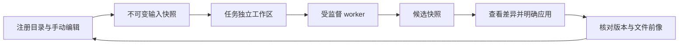

# Workbench 加固契约与验收记录

本轮已实现隔离执行、候选应用、统一持久化、分支摘要和项目多会话。
Windows 本地监督、协议、浏览器和相关回归已验证；真实 WSL 修复尚未完成验收。
按用户最新要求停止后续验收，提交独立本地分支，不运行全量测试，不推送远端。

## 注册目录与候选结果

接纳任务先记录实时输入快照，再把受管理文件物化到
`<state-dir>/workspaces/<run-id>/tree`。包含已保存的手动修改，不使用指向用户文件的
hardlink/symlink，也不依赖 Git 的已提交状态。运行根固定为这个独立目录，不扩大到上层仓库。
Layer 2 的额外 worktree 关闭，因为隔离已由 Workbench 管理。

成功且有文件变化的 repair 生成 ready 候选；失败、取消、重启中断的部分输出只作为证据。
注册目录仅在明确应用候选、历史恢复时写入。UI 提供文本差异、应用和放弃入口；
应用前再次核对根身份、共享项目 revision 和实时输入。用户外部编辑或其他会话已应用结果
会产生冲突，保留用户文件及候选；当前不提供自动合并。

一个项目可关联多个会话，多个进程及工作区可以同时执行。原目录应用、恢复和检查点串行，
一个候选发布会使旧项目版本的其他候选失效。不同服务仍不能同时拥有同一项目，
父子项目根的重叠所有权也仍受限制。

## 执行停止与重启

生产路径只允许可序列化的默认 executor 配置，并通过独立 worker 执行。
注入 Python 回调的测试必须明确使用 `tests/workbench_unit_service.py` 的 InlineWorker；
生产服务不会隐式降级为线程内执行。Worker 先等待 go 门，父进程完成资源登记和 OS 范围
归属后才开放请求。Worker 不负责提交 Run、分支、候选及应用元数据。

Windows 使用命名 Job Object，禁止 breakaway，关闭控制器句柄时终止成员。
退出证据包括范围为空和已知进程代际确认退出。Linux 普通会话要求委派的 cgroup v2，
配置 `FIXLOOP_WORKER_CGROUP_ROOT`，不以普通 process group 冒充完整的子进程约束。
Linux cgroup 路径未在本机实跑；Workbench repair 使用 Windows WSL/bwrap 后端。

停止和 timeout 先取消，默认宽限 1 秒，随后终止范围；本地清理等待有界。
WSL 工具另外通过持久化 sandbox binding、原生维护和 cgroup 收据核对清理，
不能只凭 Windows 客户端结束判定 Linux 执行结束。WSL 维护有自己的 15 秒超时，
因此不承诺所有取消都在 1 秒内完成。无法证明停止时持久化 unknown 状态，
整个项目所有会话拒绝新执行、候选应用和恢复，UI 提供重新检查入口。
记录或 cgroup 无法访问同样属于未知状态；仅明确的 FileNotFoundError 才允许判定资源缺失，
不能使用会隐藏访问错误的 exists() 作为停止证据。

服务锁仅证明旧控制器已经退出。重启先核对 worker 代际、命名范围和沙箱收据，
再捕获隔离输出并标记 interrupted。旧版遗留运行缺少证明时保持门禁，不宣称执行已停。
重新检查成功后写入 stopped 并解除门禁；失败不改文件。终止本地网络客户端也不能证明
远端供应商已经停止计算，但它不会继续向本地工作区写入迟到结果。

## 持久化与恢复门禁

会话、Run、事件、项目 revision、资源记录、候选、恢复 operation 和摘要缓存使用同一
`workbench.sqlite3`（schema v2）。Run 终态及事件、输出引用、候选在一个 SQLite 事务提交；
恢复历史检查点、应用收据、候选状态、共享项目 revision 和 operation 标记同事务提交。
事件和原始历史不可变。原有 v1 独立事件/恢复日志在权威数据库的一次事务中导入，
源文件保留且不修改；导入失败不提交 v2。此导入仅维持已经发布的持久化契约。

不可变 snapshot/blob 先 fsync、耐久替换，再提交数据库引用。
文件与 SQLite 仍不构成跨介质物理事务；失败可能留下未引用对象，目前没有 GC。
任意用户目录的多文件替换也不是物理原子操作：步骤意图先入库，按前像逐项写入。
混合状态在产品中明确显示，所有该项目会话阻止进一步修改。

重启只有在目标文件全部一致、无资源阻塞且没有已有恢复决定时，才补交元数据和清理备份；
不会自动重放部分文件写入。部分恢复要求明确 complete 或 rollback。
一旦恢复选择已持久化，再次中断后必须继续同一选择；UI 显示该选择并禁用相反操作。
未知外部编辑拒绝覆盖，保留现有文件及备份。

## 路径、成功状态与安装资源

`native_io_path()` 保持短、相对、普通 UNC 路径的原有拼写，仅在明确 I/O 边界为长路径
增加 Windows 扩展前缀。项目身份、逻辑 root 与序列化不携带这个前缀。
对于会改变 Win32 语义的尾部点/空格、设备名称，长路径转换明确拒绝；
现有显式扩展路径保持原样。长 SQLite、计划 blob、观察 blob、沙箱绑定和旧日志导入
均有边界验证，避免 `exists()` 漏掉深路径文件。

成功使用 `RepairStatus.FIXED` 与验证 `all_passed`，不使用枚举的字符串展示结果。
`pyproject.toml` 明确把 Web 资源放入 `src.workbench` 包；通过 Traversable 读取内容，
HTTP server 初始化检查缺失资源。安装到独立目录和直接从 wheel/zip 导入的实际 HTTP
响应均验证了五个资源的 SHA 与 MIME，不依赖当前源码目录。

## 分支上下文

每轮仍创建新的执行运行时，避免继承工具状态和旧分支执行证据。
ConversationContext 从权威历史的祖先链构建请求，默认历史预算 8000 tokens，
近期默认保留 3 轮，摘要预算 1200 tokens，单次摘要输入有界。
复用共同祖先的最长已摘要前缀并增量扩展；超长旧轮分段摘要。

缓存身份包括策略版本、模型/Provider、摘要指令、会话、输入快照和实际祖先内容。
编辑/重新执行不带入旧未来，项目快照变化使文件证据摘要失效。
摘要作为历史数据提供，并要求重新核对文件事实；原始节点及全部消息保留。
摘要失败或当前请求本身超限明确报错，不静默丢弃历史。
Artifacts 记录 raw/sent tokens、摘要轮数与缓存命中，UI 提示摘要使用情况。

## 本次验证（Windows / Python 3.14 / Edge）

按 CLAUDE.md 只运行相关测试，失败后精确复验；未运行仓库全量测试，未调用真实远端模型。

| 验证范围 | 结果与边界 |
| --- | --- |
| 安装资源 | 独立安装及 wheel/zip HTTP 两项通过 |
| 元数据事务 | 终态事件失败回滚、恢复收据失败回滚、v1 导入通过；新增深路径导入通过 |
| 隔离与并发 | 四项隔离用例通过；屏障证明两任务同时运行，第一候选应用后另一候选拒绝覆盖 |
| 进程监督 | 实际阻塞模型取消/超时、命名范围恢复、控制器强制死亡、停止未知资源后的门禁通过 |
| 真实并行项目问答 | 两个独立进程与工作区同时发起协议请求，原目录保持不变 |
| 摘要 | 六项分支/预算/失败用例及真实协议的增量摘要通过 |
| 候选恢复 | 11 项多文件边界与外部编辑用例通过，包含恢复选择再次中断 |
| 工厂/沙箱绑定/收据 | 56 项相关回归通过，新增长绑定保存与读取一项通过 |
| 会话存储/现有 UI | 65 项相关回归通过 |
| 浏览器 | chat_protocol 真实模型协议；hardening_ui 明确的持久化测试数据，均通过 |
| 其他协议与 JS | SSE 重连/失败/停止、项目所有权/鉴权两项通过；JS SSE/祖先路径单元通过 |

`hardening_ui` 验证候选预览取消、明确应用、放弃、部分恢复门禁、回滚及跨会话未知资源提示，以及恢复再次中断后显示并锁定原选择；
它没有执行真实 repair，不能替代 `project_lifecycle` 的 guarded 修复验收。

主要本地证据（均由 `.runtime-tools/` 忽略）：

- `s6-20261012T061411-984192/`：真实普通聊天浏览器日志、截图与 JSON 报告。
- `s6-20261012T063554-349287/`：候选、恢复与资源门禁浏览器报告及截图。
- `s6-20261012T062541-777493/`：SSE/鉴权生产协议报告与 JUnit。
- `s6-20261012T062542-679171/`：JavaScript 单元报告。
- `s6-20261012T063420-833296/`：真实服务进程死亡后的两项恢复协议验收。
- `hardening-cleanup-proof-final.xml`：访问错误门禁及受影响的取消/超时/重启清理五项验证。
- `hardening-protocol/`：CLI 普通聊天和只读项目问答协议证据。

复跑入口：`python tests/run_workbench_e2e.py --group hardening`。
浏览器使用 `--group browser --case chat_protocol` 或 `--case hardening_ui`；
Node/Playwright/Edge 参数沿用 [S6 指南](WORKBENCH_S6.md)。缺依赖失败，不静默跳过验收。

## 本地交付与验收边界

2026-10-12 用户明确要求“不做验收，提交本地分支，跳过全量测试”。
本轮实现及先前 S6 尚未提交的相关代码、测试和文档合并提交到
`codex/workbench-isolation-hardening`，仅本地提交，不推送或发布 PR。

先前自动审批故障阻止了 WSL 验收与 Git 写操作。手动审批恢复后，真实修复/历史隔离用例
实际运行一次，但第一项修复在发起模型请求前耗尽测试的 40 秒时限，返回 cancelled；
脚本未消费导致 teardown 同时失败。初始化超时根因尚未定位，不能报告 WSL 修复通过。
证据位于 `.runtime-tools/s6-20261012T065623-365752/`（report.json、日志、JUnit）。

遵照用户最新指令，不继续该用例、其他 WSL 修复/停止/超时/崩溃验收或
`project_lifecycle` 浏览器验收，不补跑全量测试。前文通过记录仅支持各自覆盖的范围，
本地提交不代表发布验收完成。
