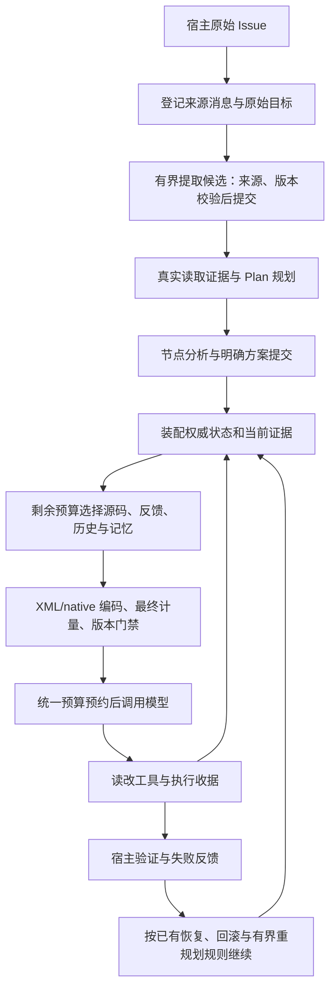

> 历史设计／实施记录，仅供人工查看。当前流程见 docs/REPAIR_CONTRACT.md。

# FixLoop 上下文主路径：面试说明

适用范围：S1–S5 的 Plan repair 主路径。入口为 `Orchestrator.repair()`，宿主接线为 `RepairPlanBinding`；L1 `agent_runtime` 不依赖 L2 `src`。

## 90 秒介绍

FixLoop 的上下文管理围绕可执行任务状态组织。每轮调用独立装配原始目标、版本化约束、当前节点决策和经核验的证据，再把剩余容量分给源码、工具反馈、历史和记忆。任务状态由 journal 恢复，摘要只帮助理解历史。

模型负责提出提取候选、技术方案和补丁。运行时负责验证来源、版本、证据、预算和执行收据。用户补充要求会产生新的 context_revision；下一轮和新委派读取新版，旧子任务结果在回收时被拒绝。补丁使旧源码证据失效，但成功补丁和测试收据仍保留，恢复时不会因此再次执行已确认操作。

单次容量与累计消耗分开管理。XML/native 请求在最终协议编码后重新计量并检查版本；必需内容超限直接阻断，可选内容按完整单位省略。manifest 说明模型实际收到哪个版本、哪些证据及何种正文形式，不能用它证明模型理解或遵循了约束。

## 主路径与组装时机



| 边界 | 动作 | 关键模块 |
| --- | --- | --- |
| 新建/恢复 repair | owner 对账，打开 journal；原始 Issue 登记和提取发生在 Plan 规划前 | `src/repair/plan_binding.py` |
| 用户补充 | 宿主安全边界停止/排空委派，再登记新消息；提取提交或显式澄清阻断 | `RepairPlanBinding.accept_user_message()`、`task_extraction.py` |
| Plan/节点方案 | 先有读取证据，再规划；明确模型方案绑定节点和有效证据 | `plan_binding.py`、`plan_runtime/context_updates.py` |
| 每次主循环模型调用 | 从 journal 状态构造 required context，核验当前输入；重新选择可选内容 | `context_manager.py` |
| 模型派发前 | 最终协议计量、请求 hash 与状态检查，调用预算预约 | `loop_protocols.py`、`model_call_budget.py` |
| 修改/验证后 | 保存操作与验证收据、刷新证据；失败进入既有反馈与有界重规划 | `plan_runtime/session.py`、`repair/pipeline.py` |

多读取节点由既有 scheduler 管理。每次模型调用的状态投影、封印历史投影和 Provider 缓存各有生命周期；不能把“每轮重建状态”理解成“每轮改写所有历史”。

## 上下文组成与权威来源

| 内容 | 来源与使用规则 | 超限/失效处理 |
| --- | --- | --- |
| 系统规则、工具协议、当前请求 | 宿主配置和本次调用；Plan 路径保护完整内容 | 必需内容超限，零模型派发 |
| 原始目标、活动硬约束 | journal；约束包含 ID/revision/status/source_refs，旧版本留档 | 完整保留；未知来源或版本冲突拒绝提交 |
| 节点决策 | 用户明确选择或有代码证据的模型方案；仅投影当前节点活动版本 | 撤销不再活动；证据/Plan 版本失效派生 needs_review |
| 当前必需证据 | EvidenceLedger 核验引用、版本和用途；状态段含核验结果及有界摘要 | 需要刷新时阻止使用旧输入继续执行 |
| 源码、工具反馈、native 尾部 | 可选正文，按用途和阶段分配弹性容量 | 装不下整项/整组省略；正文缺席不能称已消费正文 |
| 历史与摘要 | canonical 历史的可选投影；摘要不提交任务状态或收据 | L0–L5 压缩、结构校验、完整交互回退 |
| 记忆、知识、工作区说明 | 已有召回和装箱机制 | 可选省略；不获得用户消息身份 |

`RepairState.hard_constraints` 是宿主报告/checkpoint 的镜像；恢复权威仍是 Plan journal。宿主提交后同步镜像，不把过期镜像反写成新约束。

S3 只在明确接入的用户消息和 owner 可见方案边界做提取。源码、模板、日志、摘要、子任务回复、工具参数和隐藏推理不会自动成为用户约束。模型候选的结构/来源校验不能证明其语义准确；歧义需要新消息澄清。

## 压缩与可追溯性

全量/增量 L5 统一 JSON：confirmed_facts、hypotheses、rejected_hypotheses、files_changed、verification、next_action、evidence_refs。输入按完整交互装箱，输出按完整条目缩减并重新序列化；异常、超时、额度不足或格式错误走确定性回退，取消传播。

未封印历史把既有摘要与新交互合并成一个摘要。同一 run 的封印前缀保持原机制；前缀已有摘要时，尾部超限只做完整交互裁减，下一 run 再从 canonical 历史投影。既有 L1 仍可缩减普通工具正文，“完整交互”保证调用与结果关联，不承诺原始输出全文进入请求。

最终 manifest 记录 request_hash、协议、输入计量、状态/context revision、约束和当前节点决策版本、section hash、选取 ID 与 evidence_consumption。证据消费区分状态摘要、源码片段、反馈、历史正文和 native result。

S5 在历史装箱后按单位索引追踪实际 Observation，重复文本也保留各自来源。历史段最终被省略时清除其选取引用；同一引用仍在源码/反馈中则保持 selected。封印引用只在历史 section hash 匹配时沿用。dropped 是选择阶段候选的诊断，不是全部 canonical 历史的逐条省略清单，也不表示一律不可再召回。

## 预算：容量与消耗分别解释

以下是显式配置示例，未宣称对应某个已验证模型规格：

```json
{
  "prompt_budget": 8000,
  "hard_cap": 8000,
  "model_context_window": 16384,
  "max_new_tokens": 2048,
  "context_safety_margin": 256,
  "budget": {
    "prompt_tokens": 100000,
    "output_tokens": 20000,
    "total_tokens": 120000,
    "max_llm_calls": 30
  }
}
```

单次输入上限取 `min(prompt_budget, hard_cap, model_context_window - 本次输出预留 - safety_margin)`。示例为 8000；窗口配置为 0 表示未知，运行时不猜规格。规划、提取、摘要有自己的本次输出额度，不能把主循环输出额度直接套到所有辅助调用。

累计账本分别限制输入、输出、总 token 和逻辑调用次数，purpose 区分 repair/planning/exploration/extraction/summary。派发前预约，返回按 usage 结算；没有 usage 正常返回记 estimated，中断无确认用量记 unknown 并保留预约。额度不足阻断后续调用，真实超预约用量仍记录。

子任务先在父账本预留 scope；子账本约束内部执行，归并只结算一次。已记录预算在恢复后继续生效。普通模型调用在既有 checkpoint 安全边界保存；S3 提取额外在 journal 中持久化派发预约。不能承诺任意崩溃时所有物理 Provider 请求都有精确持久化账目，Provider 内部重试未暴露时也不能按逻辑调用数推断物理请求数。

## 多 Agent 与恢复

委派携带有界、独立的目标、约束、当前节点决策、Plan 引用和 context_revision，不复制整份父对话。父账本、任务 scope、deadline、只读工具范围共同约束子任务。回收重新校验 workspace、Plan、上下文版本、结果及 Observation；旧结论拒绝归并，完成结果的再次查询不自动重执行。

重启先由 owner 对账执行资源，再从 journal 重建任务状态和 Plan。旧 checkpoint 的上下文文本与 RepairState 镜像不能覆盖 journal；操作状态未确认时阻断继续执行。已确认成功操作使用收据及匹配版本恢复。补丁改变源码后旧读取证据失效，应刷新后续输入；已成功副作用不能因证据失效被自动重放。

## 三个口述案例

**历史很长，压缩后还记得“不许改测试”吗？** 原始要求先登记并提交为版本化约束；每轮 required state 完整携带活动约束。摘要即使遗漏或提出相反建议，也不能改写它。历史预算耗尽可以省略历史；required state 装不下则阻断。保障的是状态和请求契约，遵循能力仍需要真实模型评估。

**刚打完补丁就崩溃，会再次修改吗？** 读取证据绑定旧文件版本，补丁后它会失效；执行收据记录已确认修改及新版本。恢复先对账，匹配收据时采用已有 diff，已确认验证结果也可采用。缺失或 uncertain 收据不能猜成功，要进入恢复阻断。这里避免已确认操作重放，并未宣称所有工具具备通用 exactly-once。

**子 Agent 已找到位置，用户又改变要求怎么办？** 宿主在安全边界接入新消息，候选通过来源和版本校验后增加 context_revision。旧任务快照保留供审计，但回收返回 task_context_changed，旧 findings 不回流；新委派使用新版目标/约束和当前节点决策。撤销也更新版本，不能复活旧快照。

## 支持范围与面试表述边界

| 路径 | 已接入能力 |
| --- | --- |
| 普通 L1 `Agent.ask()` | 单次请求边界、已有历史压缩和预算；没有 PlanSession 时不具备完整任务 journal 与 S3 提交语义 |
| Plan repair 主路径 | 统一运行预算、来源提取、版本化提交、必需状态、证据核验、委派与恢复接线 |
| 外围独立调用/独立 Explorer | 仅声明其实际绑定的账本和入口；不能默认均纳入某次 repair 的累计消耗或 Plan 权威状态 |

本阶段保留既有 Provider 缓存、封印前缀和摘要缓存机制，没有优化缓存 hit 或迁移全部入口。MVP 不增加聊天 UI、第二套状态数据库、语义冲突裁决器或付费模型评测。受控 provider + 真实文件/pytest 用例验证接线与失败契约，不证明摘要/提取语义准确率、线上成本收益或修复成功率提升。

实现定位与测试证据见 [S5 验收记录](S5_CONTEXT_MAIN_PATH_ACCEPTANCE_2026-10-13.md)。
